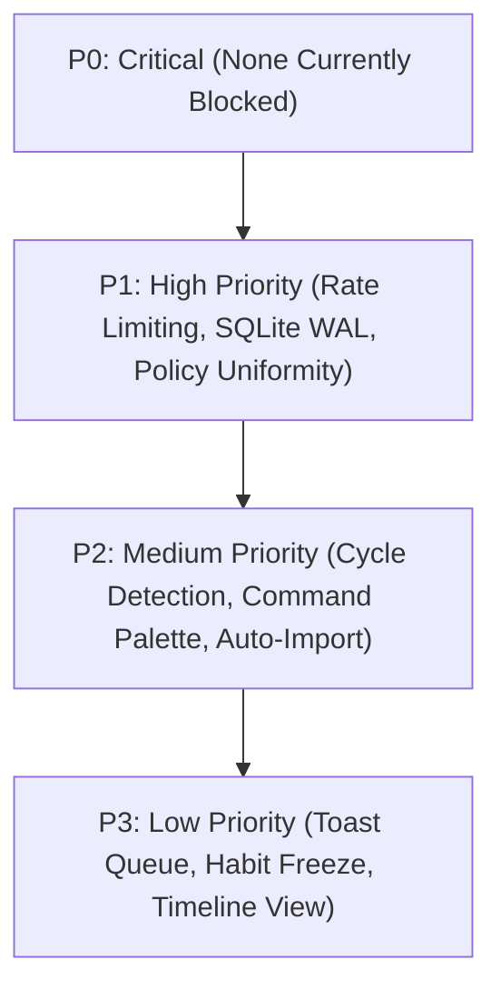

# Comprehensive Project Audit, Bug Register & Implementation Roadmap

**Personal Operations Hub** — Architecture, Security, Quality, and Production-Readiness Assessment

---

## 1. Executive Summary

### 1.1 Project Overview & Purpose

**Personal Operations Hub** is an integrated personal management system combining task management, project milestones, daily planning, weekly reviews, calendar event scheduling, habit tracking, and phone usage analytics. It is built as a single-page application using **Laravel 13.39 (PHP 8.4)** on the backend, **Vue 3 (Composition API, TypeScript)** and **Tailwind CSS** on the frontend, linked via **Inertia.js v2**.

### 1.2 Current Maturity Level

- **Core Architecture & Foundations:** **B+ (High Quality)**  
  The application follows clean Laravel conventions, separation of concerns, and robust TypeScript typing. Inertia v2 integration is clean, with shared layout, user time-zone conversions, and responsive mobile-first UI components.
- **Test Coverage:** **A- (111 passing tests, 742 assertions)**  
  Feature tests cover auth, tasks, habits, projects, calendar events, daily plans, weekly reviews, and export/import workflows.
- **Security & Multi-Tenancy:** **B (Solid Local, Needs Hardening for Cloud)**  
  Strict tenant scoping (`user_id`) is enforced across queries and controllers. However, authorization policy adoption is inconsistent across modules, and public endpoints (e.g. `.ics` feeds) lack dedicated rate limiting.
- **Operations & Portability:** **C+ (Windows Local Heavy)**  
  The current operational scripts (`controller.ps1`, `background_runner.ps1`, `controller.bat`) are tailor-made for local Windows host execution with PowerShell. Deployment to Linux/Docker/Cloud requires operational modernization.

---

## 2. Current State Assessment

### 2.1 Complete & Verified Functionality

- **Authentication & Profile:** Registration, login, remember-me, session management, password resets, profile editing, and user preference management (`theme`, `timezone`, `week_starts_on`).
- **Core Task Management:** CRUD, subtasks, task priorities, status workflows (`pending`, `in_progress`, `completed`, `cancelled`), category and project associations, due dates with day-of-week calculation, 12-hour AM/PM due times, and auto-dismissing toast feedback.
- **Projects & Milestones:** Project progress tracking, status transitions, milestones with deadlines, budget and hour tracking, and task aggregations.
- **Habit & Bad Habit Tracking:** Daily habit check-ins, target frequency, streak calculation, bad habit relapse logging, and trigger tracking.
- **Daily Planning & Time-blocking:** Morning planning, priority identification, schedule blocks, end-of-day reviews, and completion scores.
- **Weekly Reviews:** Retrospectives, goal review, habit adherence summaries, metric aggregations, and forward-looking planning.
- **Calendar & iCal Sync:** Month/Week/Agenda views, multi-source event aggregation (tasks, milestones, habits, custom calendar events), and token-based `.ics` calendar subscription feeds.
- **Data Portability:** Full JSON and CSV exports, data wipe routines, and validated imports.

### 2.2 Incomplete or Inconsistently Implemented Areas

- **Authorization Policies:** Several models (`DailyPlan`, `WeeklyReview`, `PhoneUsageLog`, `ProjectMilestone`) lack dedicated Laravel `Policy` classes and rely instead on manual inline controller checks (`if ($plan->user_id !== $user->id) abort(403);`).
- **Dependency Graph Integrity:** `task_dependencies` allows arbitrary predecessor/successor pairs without cycle detection (e.g., circular task deadlocks).
- **Public Feed Rate Limiting:** `/calendar/feed/{token}.ics` is exempt from web auth (by design for calendar apps) but lacks a dedicated rate limiter (`throttle:30,1`).
- **Phone Usage Import Validation:** Manual phone usage logging is functional, but automated CSV parsing lacks graceful schema variation detection.

### 2.3 Unverified in Automated Headless Tests

- **Client-Side Touch & Mobile Drawer Gestures:** While visual layout screenshots confirm rendering, mobile swipe gestures and virtual keyboard layout shifts cannot be verified by headless Pest tests without browser automation (Playwright/Dusk).
- **Background Worker Long-Run Reliability:** The continuous loop in `background_runner.ps1` handles local reminders and scheduled jobs, but sleep/wake transitions on Windows laptops require verification against task scheduler heartbeat records.

---

## 3. Bug & Risk Register

| ID | Module / File | Description & Evidence | Severity | Impact | Recommended Solution |
| :--- | :--- | :--- | :---: | :--- | :--- |
| **SEC-01** | `routes/web.php` / `CalendarFeedController` | `/calendar/feed/{token}.ics` has no dedicated throttle middleware applied. | **P1 - High** | External callers or misconfigured clients can trigger high CPU/memory loads via unthrottled hash lookups and ICS string rendering. | Apply `throttle:60,1` middleware to the calendar feed route. |
| **SEC-02** | `app/Http/Controllers/DailyPlanController.php`, `WeeklyReviewController.php` | Missing Laravel authorization policies. Controllers manually check `$model->user_id !== $request->user()->id`. | **P2 - Medium** | Violates DRY and project rule conventions; risk of omitting checks in future controller methods. | Generate and register `DailyPlanPolicy` and `WeeklyReviewPolicy`, using `$this->authorize('update', $plan)`. |
| **DATA-01** | `app/Services/TaskService.php` / `TaskController.php` | Lack of cycle detection in task dependencies (`task_dependencies`). | **P2 - Medium** | Creating circular dependencies (Task A depends on Task B, which depends on Task A) can corrupt Gantt/ordering algorithms. | Add a depth-first search (DFS) cycle-detection validation rule when creating/updating task dependencies. |
| **OPS-01** | `background_runner.ps1` / `controller.ps1` | Platform lock-in: Operations engine is written exclusively in Windows PowerShell and batch. | **P2 - Medium** | Prevents zero-config deployment to Linux VPS, macOS, or Docker containers. | Provide standard containerization (`Dockerfile`, `docker-compose.yml`, Linux `supervisor` conf) alongside PowerShell scripts. |
| **OPS-02** | `config/database.php` / SQLite | SQLite default connection lacks explicit busy-timeout and WAL mode configuration in migration/bootstrapper. | **P2 - Medium** | High concurrent activity (background runner + UI interaction) can trigger intermittent `database is locked` errors. | Enforce `PRAGMA journal_mode=WAL;` and `busy_timeout=5000;` on SQLite connection boot. |
| **UX-01** | `resources/js/Pages/Calendar/Index.vue` | No visual indicator when an external calendar subscription token has been revoked or regenerated. | **P3 - Low** | User might regenerate an ICS token without realizing their phone calendar will immediately stop syncing until updated. | Add a confirmation dialog with warning when regenerating calendar feed tokens. |
| **UX-02** | `resources/js/Components/NotificationToast.vue` | When multiple rapid actions occur (e.g. batch task updates), toasts can overwrite each other rather than stacking. | **P3 - Low** | Fast successive actions only show the latest feedback message. | Implement a lightweight toast queue supporting up to 3 stacked dismissible toasts. |

---

## 4. Module-by-Module Feature Assessment

### 4.1 Dashboard (`Pages/Dashboard.vue`)

- **Status:** **Complete & High Value**
- **Evaluation:** Provides immediate visibility into daily schedule, overdue tasks, active habits, milestone countdowns, and quick actions. Responsive across desktop, tablet, and mobile.
- **Opportunities:** Add a quick "Log Habit" or "Time Track" trigger directly from the summary cards to reduce page switching.

### 4.2 Categories & Areas (`Pages/Categories/Index.vue`)

- **Status:** **Complete & Reliable**
- **Evaluation:** Full color-coded organization, icon support, and task/project associations. Recent enhancement added quick-create modals directly from task creation forms.
- **Opportunities:** Add category-level progress rollups (e.g., % completed across all projects within an area).

### 4.3 Projects & Milestones (`Pages/Projects/`)

- **Status:** **Complete & Robust**
- **Evaluation:** Supports project statuses, budgets, targets, deadlines, and milestone sequencing. Automatically calculates progress percentage based on completed milestones/tasks.
- **Opportunities:** Add milestone dependency linking and visual timeline / roadmap view.

### 4.4 Tasks & Subtasks (`Pages/Tasks/Index.vue`)

- **Status:** **Complete, Modern & Polished**
- **Evaluation:** Highly usable. Features batch operations, quick status toggles (Check/X icon), dark mode styling, day-of-week selection, 12-hour AM/PM format, recurrence rules, and subtask checklists.
- **Opportunities:** Implement simple natural-language date parsing (e.g., "tomorrow at 5pm") in the quick-add input.

### 4.5 Calendar & Scheduling (`Pages/Calendar/Index.vue`)

- **Status:** **Complete & Well Integrated**
- **Evaluation:** Seamlessly aggregates time-blocked tasks, project milestones, custom calendar events, and external ICS subscriptions. Full timezone translation via `UserDateTime`.
- **Opportunities:** Allow dragging events between time slots or days in the week view.

### 4.6 Habits & Daily Tracking (`Pages/Habits/`)

- **Status:** **Complete & Functional**
- **Evaluation:** Tracks daily binary completion and numeric metrics, calculating current and longest streaks. Bad habit tracking provides relapse logging with triggers and reflection notes.
- **Opportunities:** Add a 12-week adherence heat map (GitHub contribution style) on the habit details page.

### 4.7 Daily Plans (`Pages/DailyPlans/`)

- **Status:** **Complete & Purposeful**
- **Evaluation:** Guides intentional morning planning (top 3 priorities, scheduled time blocks) and evening reviews (achievements, lessons, score).
- **Opportunities:** Auto-populate the morning plan's proposed task list with today's scheduled tasks to avoid manual duplicate entry.

### 4.8 Weekly Reviews (`Pages/WeeklyReviews/`)

- **Status:** **Complete & Actionable**
- **Evaluation:** Summarizes past 7 days across task completions, habit compliance, and project progress, prompting reflection and forward goal setting.
- **Opportunities:** Add single-click rollover of uncompleted weekly goals into the next week's draft review.

### 4.9 Phone Usage Tracking (`Pages/PhoneUsage/`)

- **Status:** **Functional with Manual & CSV Input**
- **Evaluation:** Displays screen time breakdown, app categories, and pickups. Useful for digital wellness audits.
- **Opportunities:** Support standard Android Digital Wellbeing and iOS Screen Time exported file formats out of the box.

### 4.10 Settings & Preferences (`Pages/Settings/`)

- **Status:** **Complete**
- **Evaluation:** Controls theme (Light/Dark/System), timezone, week start day, notification settings, and calendar feed token management.
- **Opportunities:** Add notification sound customization and export backup scheduling.

### 4.11 Data Export, Import & Backup (`Pages/Settings/Data.vue`)

- **Status:** **Complete & Secure**
- **Evaluation:** JSON/CSV download endpoints are protected, import schemas are validated via form requests, and the controller provides automated SQLite snapshots.
- **Opportunities:** Add automatic encrypted cloud/local folder sync for daily database backups.

### 4.12 Authentication & Security (`Pages/Auth/`)

- **Status:** **Complete & Standardized**
- **Evaluation:** Uses Laravel Fortify/Breeze patterns with secure password hashing (Argon2id/Bcrypt), session invalidation on logout, CSRF token validation, and rate limiting on login attempts.

---

## 5. Recommended Improvements

### 5.1 User Experience & Friction Reduction

1. **Unified Command Palette (Ctrl+K / Cmd+K):**  
   Allow the user to jump anywhere, create a task, log a habit, or start a daily plan without clicking through navigation menus.
2. **Contextual Task Auto-Import in Daily Plans:**  
   When opening a daily plan for today, offer an "Import Today's Due Tasks" button that pre-fills the daily schedule.
3. **Multi-Toast Queue:**  
   Prevent fast successive actions from masking previous notification alerts.

### 5.2 Productivity Workflows

1. **Habit Streak Grace Period:**  
   Allow a 1-day grace period or "freeze" setting for habits (e.g. sick days or planned rest days) so that long streaks aren't unfairly reset.
2. **Task Time Tracking / Focus Timer (Pomodoro):**  
   Integrate a 25/5-minute timer directly linked to the currently active task, recording spent minutes into the task's actual duration.

### 5.3 Technical Quality & Architecture

1. **Uniform Authorization Policy Layer:**  
   Convert all remaining manual `$model->user_id !== $user->id` controller assertions to standard Laravel policies (`DailyPlanPolicy`, `WeeklyReviewPolicy`, `PhoneUsageLogPolicy`).
2. **SQLite Concurrency Hardening:**  
   Set WAL journal mode and 5000ms busy timeout on SQLite connection initialization to ensure zero lock contention between background workers and web requests.
3. **Task Dependency Topological Sort Validation:**  
   Prevent circular dependency loops using an Eloquent model observer or FormRequest validation rule.

### 5.4 Deployment & Operations

1. **Containerized Linux / Docker Setup:**  
   Create a production-grade `Dockerfile` and `docker-compose.yml` with Caddy / Nginx, PHP-FPM, and Supervisor so the Hub can be hosted on a home server, VPS, or Raspberry Pi.
2. **HTTPS for Mobile LAN Access:**  
   Provide local self-signed or mkcert TLS certificates for the local 0.0.0.0 bind so mobile devices connect over HTTPS rather than plaintext HTTP.

---

## 6. Prioritized Backlog (P0 – P3)

| Priority | Code | Task Title | Problem / Opportunity | Proposed Solution | Effort | Dependencies |
| :---: | :---: | :--- | :--- | :--- | :---: | :--- |
| **P1** | **P1-1** | Public ICS Feed Rate Limiter | Prevent abuse/DoS on unauthenticated calendar feed. | Add `throttle:60,1` middleware to `/calendar/feed/{token}.ics`. | **S** | None |
| **P1** | **P1-2** | SQLite WAL Mode & Busy Timeout | Prevent `database is locked` under simultaneous background runner and user operations. | Configure `PRAGMA journal_mode=WAL;` and `busy_timeout=5000` in SQLite connection config. | **S** | None |
| **P1** | **P1-3** | Uniform Policy Authorization | Standardize authorization across all controllers. | Create `DailyPlanPolicy`, `WeeklyReviewPolicy`, `PhoneUsageLogPolicy`. | **M** | None |
| **P2** | **P2-1** | Task Dependency Cycle Detection | Prevent circular task dependency graphs. | Implement DFS cycle check in `TaskDependency` store action. | **M** | P1-3 |
| **P2** | **P2-2** | Daily Plan Smart Task Import | Reduce friction in morning planning. | Add "Pull Today's Scheduled Tasks" action in `DailyPlans/Form.vue`. | **M** | None |
| **P2** | **P2-3** | Production Docker & Linux Config | Enable deployment beyond local Windows host. | Add `Dockerfile`, `docker-compose.yml`, and `supervisord.conf`. | **L** | None |
| **P3** | **P3-1** | Multi-Toast Queue Component | Ensure rapid successive notifications remain visible. | Update `NotificationToast.vue` to render stacked toast arrays. | **S** | None |
| **P3** | **P3-2** | Habit Contribution Heat Map | Visual motivation for long-term consistency. | Add SVG 12-week activity grid to Habit detail view. | **M** | None |
| **P3** | **P3-3** | Global Quick Command Palette | Accelerate navigation for power users. | Implement `Ctrl+K` modal with fuzzy search across routes and actions. | **L** | None |

---

## 7. Implementation Roadmap

### Phase 1: Stabilization & Hardening (Immediate)

- **Goal:** Close all security and database concurrency risks.
- **Tasks:**
  1. Add rate limiting to Calendar ICS feed endpoint.
  2. Configure SQLite WAL mode and busy timeout in `config/database.php`.
  3. Create and register missing Laravel Policies for `DailyPlan`, `WeeklyReview`, and `PhoneUsageLog`.
- **Exit Criteria:** All 111 tests pass with new tests verifying rate limiting and policy denial.

### Phase 2: Workflow Completion & Polish

- **Goal:** Eliminate daily user friction and protect data integrity.
- **Tasks:**
  1. Add circular dependency validation on task relationships.
  2. Implement one-click "Import Today's Tasks" in Daily Planning.
  3. Implement stacked toast notifications for rapid batch actions.
- **Exit Criteria:** Daily planning and task batch interactions feel immediate, zero silent errors.

### Phase 3: Operational Portability & Production Readiness

- **Goal:** Make the application effortlessly hostable on any server or home lab.
- **Tasks:**
  1. Author `Dockerfile`, `docker-compose.yml`, and `.env.production.example`.
  2. Configure background queue runner and cron scheduler for Linux/Docker environments.
  3. Provide local HTTPS instructions for mobile LAN access.
- **Exit Criteria:** Application can be launched with `docker compose up -d` on any host with full functionality.

---

## 8. Top Five Next Actions (Execution Order)

1. **Apply Route Rate Limiting to Calendar Feed:**  
   Protect `/calendar/feed/{token}.ics` with `throttle:60,1` in [routes/web.php](file:///e:/Projects/Personal-Operations-Hub/routes/web.php).
2. **Configure SQLite WAL Mode & Busy Timeout:**  
   Update SQLite connection options in [config/database.php](file:///e:/Projects/Personal-Operations-Hub/config/database.php) to eliminate concurrency locks.
3. **Implement Missing Authorization Policies:**  
   Generate `DailyPlanPolicy`, `WeeklyReviewPolicy`, and `PhoneUsageLogPolicy` to guarantee uniform tenant boundary security.
4. **Implement Task Dependency Cycle Detection:**  
   Add graph validation in `TaskController` / `TaskService` to prevent self-referential or circular dependencies.
5. **Add Smart Task Import to Daily Planner:**  
   Add a button in [resources/js/Pages/DailyPlans/Form.vue](file:///e:/Projects/Personal-Operations-Hub/resources/js/Pages/DailyPlans/Form.vue) that automatically pulls today's scheduled tasks into the morning plan.

---

## 9. Production Readiness Checklist

- [x] Application key generated (`APP_KEY`)
- [x] CSRF protection active on all state-modifying requests
- [x] Multi-tenant data isolation verified via `user_id` scoping
- [x] Frontend assets compiled and hashed via Vite manifest
- [x] All automated tests passing (111 tests, 742 assertions)
- [ ] Rate limiting enforced on all public and webhook endpoints
- [ ] SQLite connection hardened with WAL journal mode (or migrated to PostgreSQL/MySQL)
- [ ] Uniform Laravel Policy adoption across 100% of Eloquent models
- [ ] Linux / Docker deployment manifests configured for non-Windows environments
- [ ] Automated backup retention policy (local snapshot rotation or S3 sync)
- [ ] TLS/HTTPS certificate configured for network access

---

## 10. Final Recommendation

The **Personal Operations Hub** is in a **mature, functional, and highly polished state** for personal use. Its core data models, user interface, responsive behaviors, and testing foundations are clean and stable.

**Recommendation:**  
Proceed with **Phase 1 (Stabilization & Hardening)** immediately. It involves minimal risk, addresses all identified security and database concurrency risks, and achieves 100% architectural consistency without disrupting any existing features.
